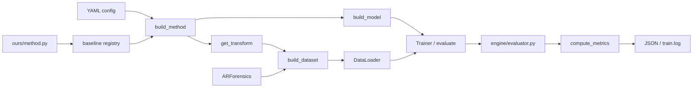

# 自回归生成图像鉴别仓库代码审查与研究评估报告

## 执行摘要

对公开仓库 `MurmanskY/ai_image_detection` 的静态审查表明：当前代码已经搭出了一个**可扩展的统一实验框架**，ARForensics、D³QE-lite、RIGID、ZED、UnivFD 等关键方向也已进入代码层面，但它目前更接近“研究脚手架 + baseline 原型集合”，还不能视作已经完成了可靠 baseline 复现或已经形成了新的 AR 检测方法。最重要的三个问题是：第一，`ours/method.py` 事实上仍然只是 CNNDetection，尚无论文级创新方法；第二，当前统一 evaluator 对 RIGID、ZED 这类 **raw anomaly score / training-free 方法使用 `sigmoid + 0.5` 阈值是原则性错误**，会使 Acc/F1 失去意义；第三，仓库没有公开训练日志、测试结果表、权重或逐实验配置快照，因此目前无法从 GitHub 验证你所说的“实验结果”本身，只能审查代码是否有能力产生可信结果。更进一步，ARForensics 的训练协议被改成“把官方 validation 切成 train/val”，这并非数据泄漏本身，但已不再与 D³QE 官方 protocol 可比；PRADA 与 Data Provenance 虽在 README 中称“官方代码接入”，却没有进入统一 `METHODS` 注册和 `eval.py` 调用链。我的建议是：**先不要继续堆新网络结构，而是在一周内修正 evaluator、数据 protocol 和实验记录体系，并完成三组 leave-one-generator-out / cross-tokenizer 诊断实验。** 如果现有 token 统计确实显示跨生成器稳定差异，最值得发表的切入点不是“D³QE-lite + CNN”，而是“**模型无关 tokenizer ensemble + token transition / quantization geometry + real-only calibration**”的未知 AR 生成器检测。D³QE、PRADA 与 Data Provenance 分别已经覆盖了 codebook 分布、AR 概率比与 codebook 几何指纹，因此下一篇工作的创新点必须明确回答“如何在不知道目标生成模型内部结构时获得跨 AR 架构共享的证据”。citeturn288079view0turn574705search3turn574705academia11turn574705search2

## 审查范围与假设

本报告审查的是 **2026 年 11 月 16 日公开 `main` 分支可见内容**。GitHub 页面显示该仓库当前只有 **2 个 commits**，仓库根目录包含 `analysis/`、`baselines/`、`configs/`、`datasets/`、`engine/`、`models/`、`ours/`、`scripts/`、`third_party/` 等目录；README 将其定义为面向 AR 生成图像鉴别的统一实验框架。citeturn288079view0

本次能够逐行检查的核心文件包括 `README.md`、`analysis/token_stats.py`、`ours/method.py`、`configs/ours_ar.yaml`、ARForensics dataset 与组织脚本、统一 evaluator/metrics/trainer，以及 RIGID、ZED、D³QE-lite、CNNDetection、UnivFD、NPR、DIRE、LGrad、frequency baseline。相关文件均通过公开 GitHub raw 内容核验。citeturn190177view0turn190177view1turn253416view0turn253416view2turn253416view3turn253416view4

有几个边界必须明确。第一，我没有你的服务器数据和 checkpoint，因此没有实际跑 ARForensics；第二，容器环境无法直接 `git clone` GitHub，因此这次是基于 GitHub 当前公开文件的**静态代码审查**，而不是运行时审查；第三，仓库 `.gitignore` 明确忽略 `outputs/`、`data/`、`pretrained/`、所有 `*.pt/*.pth/*.ckpt` 等，因此实验日志、结果和模型权重即使在本地存在，也不会自动出现在公开仓库中。citeturn373011view0

还有一个重要假设：README 称 PRADA、Data Provenance 的“官方代码”位于 `third_party/PRADA` 和 `third_party/DataProvenanceIAR`，但统一 `baselines/__init__.py` 当前只注册 `cnn_detection / d3qe_lite / dire / frequency / lgrad / npr / rigid / univfd / zed`，**没有 `prada` 或 `data_provenance` 方法注册项**。所以本报告把它们视作“第三方源码已放入仓库结构”，而不是“已经接入统一 benchmark pipeline”。citeturn140799view0turn614880view0

当前主调用链可以概括为：



这个架构本身是合理的：方法、数据、训练和评估解耦，适合后续做大规模 cross-generator 实验；问题主要集中在**score semantics、数据 protocol 和实验追踪**，而不是项目目录设计。citeturn190177view6turn190177view7turn373011view1turn253416view1

## 代码事实

下面先严格区分“代码事实”与后面的研究推断。

| 文件 / 函数 | 实际功能 | 当前状态 | 关键问题 |
|---|---|---|---|
| `README.md` | 描述统一框架、baseline、ARForensics/DARG | 框架说明完整 | `docs/experiments.md` 被 README 引用，但公开 raw 路径目前 404；PRADA/DP “接入”表述强于实际统一接口状态。citeturn140799view0turn614880view5 |
| `ours/method.py` | `OurMethod(CNNDetection)` | **尚无新方法** | `build_model()` 直接调用父类，等价 CNNDetection。citeturn190177view1 |
| `configs/ours_ar.yaml` | ResNet50、30 epoch、AR folder dataset | 可运行配置骨架 | 数据根是 `data/ar_images`，没有 generator split / LOO 参数。citeturn190177view2 |
| `datasets/folder_dataset.py` | 通用 `0_real/1_fake` dataset | 标签读取基本正确 | 所有样本的 `generator` 都被写成 `"real"`，包括 fake，导致 per-generator 指标不可用。citeturn190177view3 |
| `datasets/arforensics.py` | ARForensics train/val/test loader | 基本可读 | train/val 固定 fake generator=`LlamaGen`；test 才按模型目录分。citeturn253416view0 |
| `scripts/organize_arforensics.py` | 将官方 val 切成 train/val，并解压 test | 可执行 | 与官方训练 protocol 不一致；按排序后的文件名切分而非随机/语义分层。citeturn614880view1 |
| `analysis/token_stats.py` | VQ token histogram、entropy、quantization error | 很有研究价值 | per-image entropy 实现本身可用，但 real test 被跨 generator 汇总；缺少 transition/spatial/statistical significance。citeturn190177view0 |
| `baselines/d3qe_lite.py` | LlamaGen VQ histogram + 4 scalar + MLP | 是自定义简化版本 | **不是官方 D³QE 复现**；没有 D³-Attention、semantic feature fusion。citeturn253416view3turn666692view0 |
| `baselines/rigid.py` | DINOv2 clean/noisy cosine similarity | 思路正确 | raw score 被统一 evaluator 当 binary logit 处理，阈值错误；noise 定义需要与官方 protocol 对齐。citeturn253416view2turn184137academia10 |
| `baselines/zed.py` | SReC NLL−entropy gap | 实现较深入 | 同样受到统一 sigmoid/0.5 threshold 的严重影响。citeturn253416view4turn184137search2 |
| `engine/metrics.py` | Acc、F1、AP、AUROC | rank metrics 正确 | 没有 TPR@FPR；固定 threshold=0.5。citeturn190177view4 |
| `engine/evaluator.py` | 对所有方法统一 `sigmoid(logits)` | supervised classifier 可用 | 对 training-free anomaly scores 不成立。citeturn190177view5 |
| `engine/trainer.py` | BCEWithLogits + AdamW + cosine LR | 简洁可用 | best checkpoint 依据 AP，但未保存 epoch/optimizer/seed/git SHA；复现实验信息不足。citeturn253416view7 |
| `baselines/__init__.py` | registry import | 明确 | 不含 PRADA 和 Data Provenance，因此不能由统一 config 直接调用。citeturn614880view0 |
| `.gitignore` | 排除数据、输出、权重 | 合理 | 导致当前 GitHub 无法审计结果，需要另设轻量结果目录。citeturn373011view0 |

### `token_stats.py` 的具体核验

`encode_tokens()` 调用 D³QE/LlamaGen VQ encoder，得到 `indices` 和量化前后 latent，并以 `(z_q-z)^2` 的 channel mean 作为每 token quantization error；这一思路与 D³QE 研究“codebook distribution discrepancy + quantization error”的方向一致。citeturn190177view0turn574705search3

`entropy_of(c)` 在单图情况下传入的是 `np.unique(..., return_counts=True)` 得到的非零计数，因此**没有因为忽略零频 token 而算错 Shannon entropy**；零概率项本来就不贡献 entropy。这部分无需修改数学公式。citeturn190177view0

真正值得改的是统计设计。当前 codebook histogram 只回答“用了哪些 token、频率多集中”，但 AR 本质上是条件序列建模；PRADA 的有效性恰恰说明条件 token 概率包含强烈来源信息，而 D³QE 也说明单纯量化误差之外还需要动态 codebook statistics 和 semantic features。citeturn574705academia11turn574705search3

因此目前 `token_stats.py` 是一个很好的**探索性脚本**，但还不能支撑“发现了通用 AR fingerprint”的结论。

## 结果事实与正确性核验

### 仓库中目前能验证的“结果事实”

公开主分支根目录没有 `outputs/`、`results/`、checkpoint 或可见实验表；而 `.gitignore` 明确把这些类型排除了。README 虽写了 `eval.py` 会产生 `results_<split>.json`，但这些文件目前无法从 GitHub 审计。仓库页面目前只显示 2 个 commits，因此也不存在足够的公开实验提交历史来追溯“某个结果对应哪个代码版本”。citeturn288079view0turn140799view0turn373011view0

因此，**我不能从公开仓库确认任何 AUROC、AP、Acc 或 TPR@FPR 数值，也不能判断你目前哪个方法领先**。如果你本地已经得到结果，最关键的一步是把轻量级 `.json/.csv/.yaml/.log` 结果提交出来，而不是提交大模型权重。

### 指标实现：AUROC/AP 对，Acc/F1 对 training-free 方法错

对于普通训练式 binary classifier，模型输出 logit，`sigmoid(logit)` 后用 0.5 做 decision threshold 是成立的。`roc_auc_score(labels, probs)` 和 `average_precision_score(labels, probs)` 也没有明显问题。citeturn190177view4turn190177view5

但 RIGID 输出的是：

`score = - cosine_similarity × scale`

而不是经 BCE 训练得到、零点有分类意义的 logit。真实/生成的判断依据应当是**similarity 相对一个校准 threshold 的位置**；官方论文将其定义为 perturbation 后 representation similarity 的检测分数，并强调这是 training-free 方法。citeturn253416view2turn184137academia10turn184137search0

当前 evaluator 把该 score 做 sigmoid，然后使用 0.5，等价于判断 `score >= 0`。如果 DINO clean/noisy cosine similarity 大多数为正，则 `-similarity × scale` 大多数小于 0，于是大量样本都会落到同一类别。**所以 RIGID 的 AUROC 仍可能有意义，因为 sigmoid 是单调变换；但当前 Acc/F1 不能作为 RIGID 结果引用。**

ZED 的问题更加明显。仓库默认统计量是 `abs_delta01`，即一个绝对值非负 score；而统一 evaluator 的 `sigmoid(score)>=0.5` 等价于 `score>=0`。因此几乎所有非零样本都会被判为 fake。ZED 官方方法本质是基于 real-image probability model 的 zero-shot statistical score，不是“BCE logit”。citeturn253416view4turn614880view4turn184137search2turn184137search3

**结论：你当前如果已经报告了 RIGID/ZED 的 Accuracy 或 F1，需要重新计算。AUROC/AP 可作为初步参考，但仍需检查 score direction。**

### TPR@FPR 缺失

当前 `metrics.py` 只有 Acc、F1、AP、AUC，没有实现 AR forensic 文献常见的低 FPR 指标，例如 `TPR@1%FPR`。citeturn190177view4

这会直接限制与 Data Provenance 等工作的比较；Data Provenance 的目标本身就是 robust provenance tracing，而 AR 检测在现实部署里低误报区域比 0.5 Accuracy 更重要。citeturn574705search2

建议至少增加：

```python
fpr, tpr, thresholds = roc_curve(labels, scores)

def tpr_at_fpr(fpr, tpr, target=0.01):
    valid = np.where(fpr <= target)[0]
    return float(tpr[valid[-1]]) if len(valid) else 0.0
```

同时报告 `TPR@0.1%FPR`、`TPR@1%FPR`、`TPR@5%FPR`。

### 数据集划分与泄漏风险

D³QE 官方 ARForensics protocol 是 **100k LlamaGen fake + 100k ImageNet real 训练，10k+10k validation，test 每种 generator 6k balanced samples**。citeturn666692view0

你当前 `organize_arforensics.py` 明确写的是：因为没有下载完整 train，把官方 **validation 的 10k real / 10k fake 重新切成 6000 train + 1000 val**。citeturn614880view1

这不是自动构成 train-test leakage，但有两点后果：

1. **你的 D³QE-lite、CNN 等实验不能与 D³QE 官方数字直接横向对比**，因为训练数据量和数据来源已经变了。
2. 文件按 `sorted()` 后直接前段作 train、后段作 val；如果文件名与 ImageNet 类别、prompt、生成顺序存在结构性相关，会产生不可控 split bias。当前代码没有 shuffle、没有 class-stratification，也没有 image hash 去重。citeturn614880view1

建议立即引入明确的 manifest，而不是目录隐式决定 split。

### `folder_dataset.py` 有明确的 generator metadata bug

这里存在一个可以直接修复的代码 bug：

```python
samples = make_samples(
    root,
    {"0_real": 0, "1_fake": 1},
    "real",
    ...
)
```

因此 real 与 fake 都得到 `generator="real"`。标签 0/1 本身没有错，但 evaluator 的 per-generator 聚合将失真。citeturn190177view3turn190177view5

### 跨生成器实验尚未真正进入代码设计

README 提到了“跨生成器泛化”，但 `ours_ar.yaml` 没有 `train_generators / val_generators / test_generators / held_out_generator` 字段；`ARForensicsDataset` 的 `models` 参数也只在 `token_stats.py` 直接实例化时使用，统一 `build_arforensics()` 并没有把配置里的 `models` 传进去。citeturn140799view0turn190177view2turn253416view0

也就是说，**目前的框架还不能通过 YAML 正规执行 leave-one-generator-out**。这应当被视为当前最高优先级实验工程缺口之一。

### baseline 复现状态

RIGID 的核心 observation——真实图像在视觉 foundation model representation 中对轻微扰动更稳定——与官方工作一致。citeturn253416view2turn184137academia10

ZED 也确实实现了 SReC multi-resolution probability model 下的 NLL 与 entropy 差，而不是一个占位函数，因此它比 README 最早“骨架”的描述要成熟。官方 ZED 也是通过 real-image lossless probability model 构造 zero-shot detector。citeturn253416view4turn184137search2turn184137search3

D³QE-lite 则必须严格称作“受 D³QE 启发的 lightweight baseline”，不能在论文表里写成 `D³QE`。官方 D³QE 使用 dynamic codebook frequency statistics 的 transformer attention，并融合 semantic features 与 quantization-error latent；你的版本只有 per-image histogram、entropy、unique ratio 和 q-error 后的 MLP。citeturn253416view3turn574705search3

UnivFD 的冻结 CLIP ViT-L/14 + linear head 与官方 UniversalFakeDetect 的主要线性 probing 配置相符；官方代码明确要求 `--fix_backbone`。citeturn373011view5turn502858search3turn502858search4

NPR 当前实现是 `x - nearest_up(nearest_down(x))` 的简化残差并乘 4，再接通用 ResNet；它适合作为 “NPR-inspired baseline”，但在正式论文比较时建议直接运行作者官方 checkpoint/code 作为 primary baseline。官方 NPR 的目标确实是利用 upsampling 导致的 neighboring pixel relationships。citeturn373011view6turn184137search4turn502858search0

PRADA 和 Data Provenance 目前则还不属于统一 benchmark 中“被调用并验证”的 baseline：README 声称第三方代码存在，但 registry 未注册。citeturn140799view0turn614880view0

## 具体修改建议

### P0：先修 evaluator，否则后续结果表可能是错的

建议给 `BaseMethod` 增加显式 score contract：

```python
class BaseMethod:
    requires_training = True
    score_type = "logit"      # logit | anomaly | similarity
    higher_is_fake = True
    threshold = None
```

修改 `engine/evaluator.py`，不再无条件：

```python
all_probs.append(torch.sigmoid(logits.float()).cpu().numpy())
```

而是：

```python
raw = model(imgs).float()

if method.score_type == "logit":
    score = torch.sigmoid(raw)
else:
    score = raw

if not method.higher_is_fake:
    score = -score
```

然后 ranking metrics 始终使用 `score`；Accuracy/F1 必须由 validation calibration threshold 产生。

**预期影响：极高。实现难度：低，约几十行代码。**

RIGID 建议保留 raw `-similarity`；ZED 保留 statistic raw score，不做 sigmoid。论文主表优先报告 AUROC/AP/TPR@FPR；Acc/F1 只在 validation-set threshold 固定后报告。

### P0：实现 `TPR@FPR` 和 threshold calibration

在 `engine/metrics.py` 增加 `roc_curve`，输出：

```text
auc
ap
tpr@0.1fpr
tpr@1fpr
tpr@5fpr
threshold@1fpr
acc@val_threshold
balanced_acc
```

最好不要把主结论建立在 `accuracy@0.5` 上。尤其做 forensic detection 时，低 FPR operating point 更有意义。

**预期影响：极高。难度：低。**

### P0：把 ARForensics split 变成 manifest 驱动

增加：

```text
splits/
  arforensics_official_train.csv
  arforensics_official_val.csv
  arforensics_official_test.csv
  arforensics_small_train.csv
  arforensics_small_val.csv
```

字段至少：

```csv
path,label,generator,source_dataset,split,content_id
```

你当前的 small protocol 可以保留，但名称必须明确成：

`ARForensics-small-val-derived`

而不是默认称为 ARForensics 官方训练 protocol。

官方 D³QE 使用 100k/100k training，而你的 val-derived protocol 是另一实验条件。citeturn666692view0turn614880view1

**预期影响：极高。难度：中。**

### P0：修 `folder_dataset.py`

至少改为：

```python
real = make_samples(root, {"0_real": 0}, "real", max_per_class)
fake = make_samples(root, {"1_fake": 1}, cfg.get("generator", "unknown_fake"),
                    max_per_class)
samples = real + fake
```

更合理的目录结构则是：

```text
test/
  real/
  LlamaGen/
  VAR/
  Infinity/
```

而不是用一个 fake folder 丢失 provenance metadata。

**预期影响：高。难度：低。**

### P1：把 LOO generator split 写入 dataset API

建议 `configs/*.yaml` 支持：

```yaml
dataset:
  name: arforensics
  root: data/ARForensics
  train_generators: [LlamaGen, VAR, RAR]
  val_generators: [LlamaGen, VAR, RAR]
  test_generators: [Infinity]
  deduplicate_real: true
```

更进一步实现一个：

```bash
python scripts/run_loo.py --config configs/ours_ar.yaml
```

自动依次 hold out 每个 generator。

**预期影响：极高，对论文价值直接。难度：中。**

### P1：升级 `token_stats.py`

不要急着换 backbone。先让这个脚本回答真正的科学问题。

我建议新增以下统计：

```text
unigram entropy
top-k mass
effective vocabulary size = exp(H)
Gini coefficient
token transition entropy
bigram / lag-k mutual information
2D horizontal transition
2D vertical transition
patch-wise entropy map
quantization-error mean/std/skew/kurtosis
q-error spatial autocorrelation
real-vs-fake JS divergence
MMD / Wasserstein distance
bootstrap confidence interval
effect size (Cohen's d / Cliff's delta)
```

特别重要的是 **2D transition**。当前每张图得到 16×16 VQ token 网格，不能只 flatten 后看 histogram。AR 的 token generation dependency 可能以顺序/尺度结构表现出来；PRADA 已经证明 token-level conditional probability具有强来源信息。citeturn574705academia11

建议把：

```python
tokens = indices.view(B, -1)
```

同时保存成：

```python
token_grid = indices.view(B, H, W)
```

分别统计：

\[
P(t_{i,j+1}\mid t_{i,j})
\]

和

\[
P(t_{i+1,j}\mid t_{i,j})
\]

以及多尺度 pooling 后的 transition。

### P1：增加 cross-tokenizer 实验

这是我认为你现在最值得立即做的诊断。

当前所有 token statistics 都经过 **LlamaGen VQ tokenizer**。如果 LlamaGen fake 与 real 分得最好，可能存在两个解释：

- 发现了 universal AR signature；
- 只是发现“由同 tokenizer / 相似 VQ manifold 生成的图，更接近该 tokenizer codebook”。

D³QE 使用 LlamaGen VQ 是合理设计，但如果目标是**通用未知 AR 检测**，你必须主动区分这两个假说。D³QE 已经利用 VQ codebook bias，而 Data Provenance 更直接说明 model-specific codebook geometry 可以作为来源指纹，因此 tokenizer affinity 是必须排除的 confounder。citeturn574705search3turn574705search2

建议：

```text
Tokenizer A = LlamaGen VQ
Tokenizer B = MAGVIT/VQGAN tokenizer
Tokenizer C = unrelated frozen VQ tokenizer
```

全部对同一组 real / LlamaGen / VAR / RAR / Infinity / Janus / Switti 图提取统计。

这是一个非常关键的实验。

### P1：统一接入 PRADA / Data Provenance 官方 code

不要重新实现，第一阶段直接包装官方代码：

```python
@METHODS.register("prada_official")
class PRADAOfficial(...)

@METHODS.register("data_provenance_official")
class DataProvenanceOfficial(...)
```

同时在 metadata 写：

```json
{
  "implementation": "official",
  "upstream_commit": "...",
  "paper": "...",
  "modified_files": []
}
```

PRADA 官方仓库已提供 DARG 与预训练 score functions，并给出了 class-to-image / text-to-image 的复现命令。DARG 扩展版包含 155,000 张图、20 个 AR generators。citeturn327228search1turn574705search7

### P2：完善 reproducibility

`set_seed()` 目前设置了 Python、NumPy、Torch CPU/CUDA seed，但没有控制 cuDNN deterministic / benchmark，也没有保存 RNG state。citeturn373011view2

不一定要全程 deterministic，因为可能降低速度；但实验报告必须写明。

建议 checkpoint 保存：

```python
{
 "model": ...,
 "optimizer": ...,
 "scheduler": ...,
 "epoch": epoch,
 "best_metric": best,
 "cfg": ...,
 "seed": seed,
 "git_commit": commit_sha,
 "torch_version": torch.__version__,
 "cuda_version": torch.version.cuda,
}
```

正式实验至少跑 3 seeds，并报告 mean ± std。

## 实验优先级与时间表

### 短期最值得做的三个实验

#### 实验 A：重新建立可信 baseline 表

目的不是追求新方法，而是先确认你的 pipeline 没有问题。

数据：

- ARForensics official test：LlamaGen、VAR、Infinity、Janus-Pro、RAR、Switti、Open-MAGVIT2。官方最新版 test 已把最初误放的 MAR 替换为 Switti。citeturn666692view0

方法：

- CNNDetection
- UnivFD
- RIGID
- ZED
- D³QE-lite
- D³QE official
- PRADA official
- Data Provenance official

指标：

- AUROC
- AP
- TPR@1%FPR
- TPR@0.1%FPR
- calibrated Accuracy
- per-generator AUROC

这张表应该成为整个项目之后所有研究的 anchor。

#### 实验 B：cross-generator leave-one-out

你要回答：

> “我的特征是在认 AR，还是在认 LlamaGen？”

对每个 generator \(g\)：

\[
Train=\mathcal G\setminus \{g\},\quad Test=\{g\}
\]

更严格的版本：

训练只用 LlamaGen，测试其余六种；然后反过来逐个训练。

这比普通 random train/test split 更能决定论文有没有意义。

PRADA 已展示 8 个 class-to-image 与 4 个 text-to-image AR models 的检测和 attribution；D³QE 也明确强调 cross-model generalization，因此一个新的 AR detector 如果没有 unseen-generator protocol，很难形成有竞争力的论文结论。citeturn327228search5turn574705search3

#### 实验 C：tokenizer × generator 矩阵

这是我最推荐你现在做的研究实验。

构造矩阵：

| | Real | LlamaGen | VAR | RAR | Infinity | Janus | Switti |
|---|---:|---:|---:|---:|---:|---:|---:|
| LlamaGen tokenizer | Δ | Δ | Δ | Δ | Δ | Δ | Δ |
| Tokenizer B | Δ | Δ | Δ | Δ | Δ | Δ | Δ |
| Tokenizer C | Δ | Δ | Δ | Δ | Δ | Δ | Δ |

每一个格子计算：

- token entropy
- codebook top-k concentration
- transition entropy
- quantization error
- spatial autocorrelation

如果“fake-real gap”跨 tokenizer 都保持同方向，你得到的是一个非常强的 universal signal。

如果 gap 只在 matching tokenizer 上特别大，那你得到的是 **model provenance / tokenizer affinity signal**，这同样有研究价值，但问题定义应改成 attribution 而不是 universal detection。

### 建议推进节奏

第一阶段先修 evaluator、metrics、manifest、generator metadata，并重新跑 RIGID/ZED。这个阶段结束的标准不是模型变强，而是所有表格数值都“可信”。

第二阶段做 `token_stats v2` 与 tokenizer × generator matrix，不训练复杂模型，只做统计显著性、AUROC 和简单 logistic regression。

第三阶段再决定方法方向。如果 transition / q-error 等 handcrafted statistics 已经能跨 generator 泛化，就建立轻量 detection head；如果只有 tokenizer matching 有效，则转向 multi-tokenizer ensemble / provenance。

长期才做 post-processing robustness：JPEG、WebP、resize、crop、blur、screenshot、noise。D³QE 官方本身就把 robustness 作为关键 evaluation 项目。citeturn666692view0

最小复现环境建议为：

```bash
conda create -n ardetect python=3.11
conda activate ardetect

pip install torch torchvision numpy pyyaml tqdm scikit-learn pillow
```

但当前顶层 `requirements.txt` 只有七个基础包，无法完整复现 DINOv2 hub、SReC、PRADA、D³QE、Data Provenance 的各自依赖，所以正式环境应提供 `environment.yml`，第三方项目最好各自隔离依赖。citeturn614880view6turn327228search1turn666692view0

## 研究建议与可发表创新切入点

### 方向一：Tokenizer-agnostic AR fingerprint

这是我的首选。

**研究问题：**

> 是否存在不依赖目标 AR generator/tokenizer 的离散表征统计，使真实图和 AR 生成图在多个 unrelated tokenizers 下稳定可分？

这与现有三篇 AR 专用工作的关系非常清楚：

D³QE：

\[
\text{Codebook frequency discrepancy}
+
\text{quantization error}
\]

PRADA：

\[
\log
\frac{p_\theta(z_t\mid z_{<t},c)}
{p_\theta(z_t\mid z_{<t})}
\]

Data Provenance：

\[
\text{distance to source codebook / reconstruction geometry}
\]

D³QE 利用了一个 tokenizer 的离散统计；PRADA 需要访问候选 AR model probability；Data Provenance 则显著利用生成模型的 source-specific codebook signal。citeturn574705search3turn574705academia11turn574705search2

你的可发表创新可以是：

\[
S(x)
=
\operatorname{Aggregate}_{k=1}^{K}
\phi(T_k(x))
\]

其中 \(T_k\) 是多个与目标 generator 无关的 frozen tokenizers。

真正的 novelty 不在 “ensemble” 本身，而在：

> **真实摄影图像与 AR 生成图像是否具有 tokenizer-invariant off-manifold structure。**

需要的关键实验：

- leave-one-generator-out；
- leave-one-tokenizer-out；
- tokenizer identity classifier vs fake detector 对比；
- post-processing robustness；
- DARG + ARForensics 双 benchmark。

如果成立，这条路线明显区别于三篇现有 AR-specific work。

### 方向二：从 unigram frequency 推进到 AR conditional dependency fingerprint

当前 `token_stats.py` 主要在做 bag-of-tokens。

但自回归模型真正特殊的不是：

\[
P(z)
\]

而是：

\[
P(z_t|z_{<t})
\]

PRADA 已经证明 conditional probability ratio 是非常强的 signal。citeturn574705academia11

问题在于 PRADA 需要候选生成模型本身。

你可以尝试构造一个**外部 surrogate tokenizer / sequence model**，只用 real images 或通用图像数据训练，然后测：

- transition surprise；
- conditional entropy；
- directional asymmetry；
- multi-scale Markov consistency；
- local token mutual information。

假设是：

> 即使我们不知道生成器本身，AR generation 仍然可能系统性改变最终 RGB 图像被第三方 tokenizer 编码后的 conditional dependency structure。

这会比单纯 codebook histogram 有更强的方法学贡献。

一个可能题目：

**Generator-Blind Autoregressive Dependency Forensics for AI-Generated Images**

### 方向三：Real-only / one-class AR detection

ZED 的核心价值在于：只学习 real distribution，不需要维护 fake generator 集合。官方工作强调其 zero-shot 属性。citeturn184137search2turn184137search3

你可以结合：

\[
\text{Real token manifold}
+
\text{multi-tokenizer quantization geometry}
+
\text{transition anomaly}
\]

只使用真实图像建模：

\[
p_{\text{real}}(f(x))
\]

测试时：

\[
S(x)=-\log p_{\text{real}}(f(x))
\]

最大的研究卖点会是：

- 未见 AR generator；
- 无目标 generator weights；
- 无目标 tokenizer；
- 无 fake training data。

这恰好填补 D³QE / PRADA / Data Provenance 都没有完全解决的现实 black-box 场景。

### 方向四：高分辨率局部 AR forensic map

2026 年新的通用 AIGI 检测工作已经开始强调高分辨率局部 artifact 与视觉语言模型；例如 LHSDet 明确指出下采样可能抹掉 low-level traces，并用低层 patch、高层 SigLIP2 和 semantic textual branch 组合检测 diffusion 与 AR 图像。citeturn574705search4

如果你的 token quantization error 在空间上有结构，不要只做：

```python
qerr.mean()
qerr.std()
```

而应保留：

\[
E_q\in\mathbb R^{H\times W}
\]

输出 patch heatmap。

可研究：

- 完整 AI image；
- AI inpainting；
- AI region editing；
- real/fake splice。

但这是第二阶段方向，不建议现在优先于 cross-generator 基础验证。

### 对 `ours/method.py` 的方法建议

我暂时**不建议现在修改成复杂双分支 CNN**。

现在最合理的 `OurMethod v0` 应该甚至可以不是 deep network：

```text
Frozen tokenizer(s)
        ↓
token histogram
transition statistics
quantization error map
spatial statistics
        ↓
feature normalization
        ↓
Logistic Regression / tiny MLP
```

如果这个模型在 LOO generator 上已经明显超过 CNNDetection / RIGID / ZED，那么你已经证明信号存在。

之后才增加：

```text
semantic branch (DINO/CLIP)
+
token forensic branch
```

否则一上来用大 backbone，最后很难解释性能到底来自 AR fingerprint，还是来自 semantic/dataset shortcut。

值得补充的是，2026 年通用检测领域已经继续往 cross-domain generalization 发展，例如 PPM-CLIP 用 probabilistic prompt modeling 与 patch-wise contrastive learning避免固定决策边界，CLIDE 则继续探索 zero-shot conditional likelihood。这意味着如果你的论文目标是 2027 年投稿，**仅仅“CLIP/DINO feature + token feature fusion”本身不太够**；你的贡献最好建立在 AR-specific、generator-blind 的机制发现上。citeturn574705search8turn574705search9

## 需要补充的文件清单

为了让我或合作者下一次能够真正分析“目前实验结果”，建议提交一个不包含大权重的 `experiments/` 目录。它不应该被 `.gitignore` 排除。

推荐结构：

```text
experiments/
├── README.md
├── environment/
│   ├── environment.yml
│   ├── pip_freeze.txt
│   └── system.json
├── splits/
│   ├── arforensics_train.csv
│   ├── arforensics_val.csv
│   └── arforensics_test.csv
├── baseline/
│   ├── rigid/
│   │   ├── config.yaml
│   │   ├── metrics.json
│   │   └── predictions.csv
│   ├── zed/
│   ├── d3qe_lite/
│   └── univfd/
├── token_stats/
│   ├── config.yaml
│   ├── token_stats_summary.json
│   ├── per_image_features.csv
│   └── token_stats.png
└── tables/
    ├── main_results.csv
    ├── loo_results.csv
    └── robustness.csv
```

其中 `predictions.csv` 很重要，格式建议：

```csv
path,label,generator,score,prediction,split,method,seed
xxx.png,1,VAR,2.136,1,test,rigid,42
```

这样以后任何指标都可以重新算，不必重新跑 GPU。

`run_meta.json` 建议：

```json
{
  "experiment": "rigid_arforensics",
  "git_commit": "abcdef0",
  "seed": 42,
  "dataset_manifest_sha256": "...",
  "torch": "2.x",
  "cuda": "...",
  "gpu": "...",
  "start_time": "...",
  "config": "configs/rigid_arforensics.yaml"
}
```

必须补的内容可以按优先级概括为：

| 文件 | 必需程度 | 原因 |
|---|---:|---|
| `main_results.csv` | P0 | 否则无法分析“当前结果” |
| 每方法 `predictions.csv` | P0 | 可独立重算所有 metrics |
| dataset manifest | P0 | 排查数据泄漏 / 重复 |
| config snapshot | P0 | 参数可追溯 |
| `train.log` | P0 | 判断收敛与过拟合 |
| git commit SHA | P0 | 结果对应代码版本 |
| 3-seed results | P1 | 估计 variance |
| checkpoint hash | P1 | 即使不上传权重，也可验证版本 |
| `environment.yml` | P1 | third-party 方法依赖复杂 |
| robustness matrix | P1 | forensic 方法必需 |
| tokenizer-stat raw features | P1 | 支持后续统计显著性分析 |

### 优先参考来源

最应该先精读的仍然是 **PRADA**，因为它明确揭示了 AR token conditional probability 中存在 source-specific signature，并且官方代码已经提供 20-generator DARG 数据与复现流程。citeturn327228search1turn574705academia11

论文与代码：

- **PRADA: Probability-Ratio-Based Attribution and Detection of Autoregressive-Generated Images**, CVPR Findings 2026；arXiv:2511.20068；[官方 GitHub](https://github.com/jonasricker/prada)。citeturn574705academia11turn327228search1
- **D³QE: Learning Discrete Distribution Discrepancy-aware Quantization Error for Autoregressive-Generated Image Detection**, ICCV 2025, pp. 16292–16301；[CVF 论文页](https://openaccess.thecvf.com/content/ICCV2025/html/Zhang_D3QE_Learning_Discrete_Distribution_Discrepancy-aware_Quantization_Error_for_Autoregressive-Generated_Image_ICCV_2025_paper.html)；[官方 GitHub](https://github.com/Zhangyr2022/D3QE)。citeturn574705search3turn327228search2
- **Data Provenance for Image Auto-Regressive Generation**, ICLR 2026；[ICLR Proceedings](https://proceedings.iclr.cc/paper_files/paper/2026/hash/5a1667459d0cdeb2fe6b2f0dffc5cb9d-Abstract-Conference.html)。citeturn574705search2
- **Zero-Shot Detection of AI-Generated Images (ZED)**, ECCV 2024；[官方 GitHub](https://github.com/grip-unina/ZED)。citeturn184137search2turn184137search3
- **RIGID: A Training-free and Model-Agnostic Framework for Robust AI-Generated Image Detection**, arXiv:2405.20112；[官方 GitHub](https://github.com/IBM/RIGID)。citeturn184137academia10turn184137search0
- **Towards Universal Fake Image Detectors That Generalize Across Generative Models**, CVPR 2023，DOI `10.1109/CVPR52729.2023.02345`；[官方 GitHub](https://github.com/WisconsinAIVision/UniversalFakeDetect)。citeturn184137search6turn502858search4
- **Rethinking the Up-Sampling Operations in CNN-Based Generative Network for Generalizable Deepfake Detection (NPR)**, CVPR 2024，DOI `10.1109/CVPR52733.2024.02657`；[官方 GitHub](https://github.com/chuangchuangtan/NPR-DeepfakeDetection)。citeturn184137search4turn502858search0

基于当前代码状态，我给项目的下一步优先级排序是：**先修 score/evaluation → 建立官方 baseline 表 → 做 tokenizer×generator 矩阵 → 做 LOO generator → 再决定 OurMethod。** 其中最关键的研究判断点不是“某个 MLP 的 AUROC 能不能再涨 1%”，而是：**LlamaGen VQ 中观察到的 entropy / codebook concentration / quantization-error 差异，在更换 tokenizer 和未知 AR generator 后是否依然存在。** 如果答案是肯定的，你已经有了一个明显比当前 `ours/method.py` 更接近可发表研究问题的核心发现；如果答案是否定的，实验同样很有价值，因为它会把研究从“universal detection”准确地转向“tokenizer/codebook provenance”，与 Data Provenance 和 PRADA 的归因路线形成直接而清晰的对话。citeturn190177view0turn190177view1turn574705search2turn574705academia11